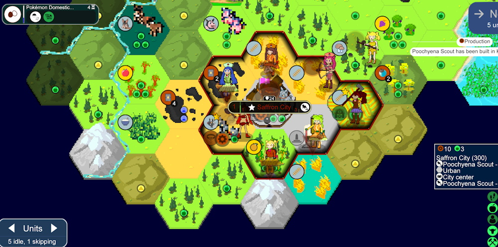

# Unciv Pokepunk - An Unciv fork for Android & Desktop

 

## What is this?

A fork of (a fork of) an open source, moddability-focused Android and Desktop remake of Civ V, made with [LibGDX] (https://github.com/libgdx/libgdx).  This specific fork is heavily modified and custom-built for the Pokepunk playset.

Develop an anime civilization in a bright, fantasy (post-apocalyptic) world where wild Pokémon roam free and replace animals, based off of the world the Pokémon series takes place in.  Many anime character crossovers from other series are also present.

Religions are reworked to be fandoms, each based off of a major anime or game series and with ample crossovers with Western works.

Featuring terraforming, building directly on the map, completely reworked combat system, five victory types (Domination, Pokopia, Tourism, Fandom, Unity), Pokémon training and combat, magic (replacing Policies), custom unit sprite arts by yours truly (as well as the PMD Sprite Repository https://sprites.pmdcollab.org/), and a fusion between historical human technological development, science fiction, magic, and of course Pokémon lore!

(Most of the fork is WIP)

## How do I install?

- **Android** - [Google Play](https://play.google.com/store/apps/details?id=com.unciv.app) or [F-droid](https://f-droid.org/en/packages/com.unciv.app/)
- **Linux** - [itch.io](https://yairm210.itch.io/unciv), Flatpak via [Flathub](https://flathub.org/apps/details/io.github.yairm210.unciv), or [AUR](https://aur.archlinux.org/packages/unciv-bin)
- **Windows** - [Grab the MSI](https://github.com/yairm210/Unciv/releases/latest/download/Unciv.msi), or get from [itch.io](https://yairm210.itch.io/unciv), [Chocolatey](https://community.chocolatey.org/packages/unciv), or [Scoop](https://github.com/Calinou/scoop-games)
- **Raspberry Pi** - [Pi-apps](https://github.com/Botspot/pi-apps)
- **MacOS** - Via [Brew](https://brew.sh/) (`brew update && brew install unciv`) or install [with this guide](https://yairm210.github.io/Unciv/Other/Installing-on-macOS/) 
- Jars, APKs and Windows/Linux builds also available in [Releases](https://github.com/yairm210/Unciv/releases) (run jar with `java -jar Unciv.jar`) - *not recommended* since we update frequently and you will quickly become out-of-date
- [Build from scratch](https://yairm210.github.io/Unciv/Developers/Building-Locally/#without-android-studio) if that's your thing

## Run with Docker 

`docker run -d -p 6901:6901 -p 5901:5901 ghcr.io/yairm210/unciv`
Then go to http://localhost:6901/vnc.html?password=headless

For more details, e.g. installing Docker, keeping saves between runs and over image updates, building the image yourself,
troubleshooting connection issues, or using a native VNC client instead of a browser, see [Building-Locally](https://yairm210.github.io/Unciv/Developers/Building-Locally/#running-via-docker).

